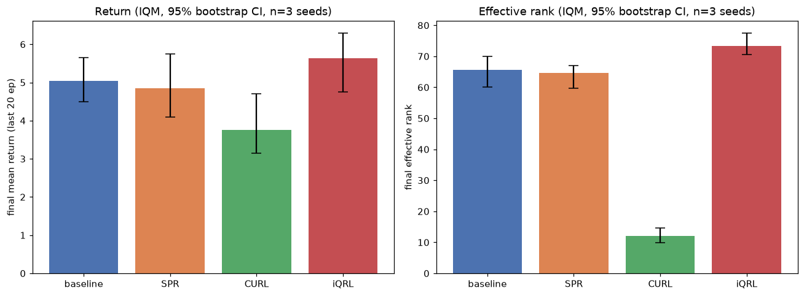

# Self-Supervised Representations for Sample-Efficient RL

**Does the anti-collapse mechanism matter? A controlled comparison of contrastive, predictive, and quantized self-supervised objectives for representation collapse resistance in sample-efficient reinforcement learning.**


## Key findings so far

MinAtar Breakout, 100k environment steps, 3 seeds per method (2 for the ablations). Bars are interquartile means with 95% bootstrap confidence intervals.



- **CURL collapses.** Effective rank drops to 12.1 [9.8, 14.7], against 65.7 [60.1, 69.9] for the no-auxiliary-loss baseline, and it has the lowest return (3.75).
- **Quantization (iQRL-style FSQ) keeps the most rank**: 73.3 [70.6, 77.6], with the highest return (5.63). Its return interval overlaps the baseline's, so the return gain isn't established yet.
- **SPR is indistinguishable from the baseline** on both measures.
- **In SPR, augmentation does the anti-collapse work.** Removing augmentation drops rank to 52.4 [50.3, 54.5]; removing the momentum target doesn't (69.7 [68.3, 71.1]).

These are early results from one game with few seeds and no hyperparameter search. The Limitations section of `notebooks/phase1_phase2_results.ipynb` covers what they can and can't support.

## Reproducing the results

`python scripts/overnight_pipeline.py` runs every training run behind the numbers above (several hours; each stage resumes from its checkpoint). It writes `notebooks/_overnight_results.json`, which `notebooks/phase1_phase2_results.ipynb` loads to produce the figure and the summary table.

## Motivation

Pixel-based RL agents need a good encoder, and reward alone is far too sparse a signal to train one quickly at low sample budgets (e.g. 100k environment steps). The standard fix is to add a self-supervised auxiliary loss to the encoder — but every self-supervised objective risks *representation collapse*, where the encoder settles on a trivial, information-free solution that technically satisfies the loss.

Three families of fix exist in the literature, each preventing collapse a different way:

| Family | Example | Anti-collapse mechanism |
|---|---|---|
| Contrastive | CURL | explicit negative sampling |
| Predictive | SPR, TCRL | momentum target network + augmentation / reward-prediction head |
| Quantized | iQRL | discretizing the latent space (FSQ), preserving representation rank |

These have never been run against each other on one matched benchmark, encoder, and base RL algorithm: SPR is Atari/Rainbow-based, TCRL and iQRL are DMControl/TD3-based, and CURL has not been benchmarked directly against either. This project builds one shared pipeline to run all three head-to-head.

## Research question

Holding the encoder, base RL algorithm, environment, and compute budget fixed — which self-supervised objective family most effectively resists representation collapse, and does the answer change as the sample budget shrinks?

## Approach

- **Base algorithm:** Rainbow-style DQN (discrete control)
- **Environments:** [MinAtar](https://github.com/kenjyoung/MinAtar) for development, scaling to the Atari-100k benchmark if compute allows
- **Objectives compared:** contrastive (CURL-style), predictive (SPR/TCRL-style), quantized (iQRL-style FSQ) — implemented as swappable auxiliary heads on an identical encoder
- **Collapse diagnostics:** effective rank / singular-value spectrum of the representation covariance, tracked through training alongside downstream score, not just downstream score alone
- **Evaluation:** interquartile mean + percentile bootstrap confidence intervals rather than raw seed averages (`diagnostics/bootstrap_ci.py`), in the spirit of [`rliable`](https://github.com/google-research/rliable) / Agarwal et al. (2021) — implemented directly rather than via the `rliable` package itself, since its 1.2.0 release turned out to be broken against `arch>=8.0` (needed for `arch` to import at all under pandas 3.x)

## Roadmap

- [x] **Phase 0** — deep RL fundamentals: PyTorch, CNN encoder, working DQN on MinAtar. Rainbow agent trained end-to-end on `breakout` for 200k steps (`notebooks/train_rainbow_minatar.ipynb`).
- [x] **Phase 1** — SPR adapted onto the Phase 0 stack. Neither SPR nor iQRL has published MinAtar numbers, so this validates each mechanism against the no-auxiliary-loss baseline instead of chasing a specific score. A 50k-step Atari-100k baseline smoke test (`checkpoints/atari_baseline_breakout.pt`) confirms the harder pixel pipeline learns correctly (after finding and fixing a missing FIRE-on-reset step in `envs/atari_env.py` — an earlier run silently produced zero reward for its entire 48k steps); the full 26-game published-number reproduction remains future work (multi-day compute commitment).
- [x] **Phase 2** — all three objectives implemented as swappable auxiliary heads on the identical Rainbow/MinAtar stack: SPR (`models/spr_head.py`), CURL (`models/curl_head.py`), and an iQRL-style FSQ-quantization head (`models/iqrl_head.py`, adapted from Scannell et al. 2024's DMControl/TD3 setting onto this project's Rainbow/MinAtar stack — see that file's docstring for what was and wasn't kept faithful to the original). Full comparison on `breakout`, 3 seeds each (2 for the two SPR ablations), IQM + 95% bootstrap CI (`notebooks/phase1_phase2_results.ipynb`):
  - **baseline** return 5.03 [4.50, 5.65], rank 65.7 [60.1, 69.9]
  - **SPR** return 4.85 [4.10, 5.75], rank 64.5 [59.7, 67.1] — statistically indistinguishable from baseline
  - **CURL** return 3.75 [3.15, 4.70], rank **12.1 [9.8, 14.7]** — clear, seed-consistent representation collapse
  - **iQRL** return 5.63 [4.75, 6.30], rank **73.3 [70.6, 77.6]** — best of the four on both metrics
  - **Ablations** (2 seeds): removing SPR's augmentation drops rank to 52.4 [50.3, 54.5]; removing its momentum target *doesn't* (69.7 [68.3, 71.1], matching or exceeding full SPR's 67.0) — augmentation, not the momentum encoder, appears to be doing SPR's anti-collapse work in this setting.
  - See the notebook's own Limitations section (single game, small/unequal seed counts, no hyperparameter search, adapted not reproduced, short budget) before treating any of this as more than a preliminary but real signal.
- [ ] **Phase 3** — write-up, arXiv preprint, workshop submission

## Repository structure

```
.
├── envs/           # MinAtar wrapper (minatar_env.py), Atari-100k wrapper (atari_env.py)
├── models/         # shared CNN encoders, SPR/CURL/iQRL auxiliary heads
├── agents/         # Rainbow agent + replay buffers + SPR/iQRL's sequence buffer
├── diagnostics/    # effective rank (effective_rank.py), IQM + bootstrap CI (bootstrap_ci.py)
├── configs/        # planned for a future multi-game comparison — one YAML per experiment variant
├── notebooks/      # train_rainbow_minatar.ipynb (Phase 0), train_spr_minatar.ipynb (Phase 1
│                   # seed-0 run), phase1_phase2_results.ipynb (final results across everything)
├── scripts/        # overnight_pipeline.py — every training run behind phase1_phase2_results.ipynb
├── checkpoints/    # trained agent weights + histories (gitignored; regenerate via the notebooks/scripts)
└── results/        # planned for a future multi-game aggregate comparison
```

## Setup

Developed on Google Colab (free tier), with checkpointing to Google Drive to survive session limits.

```bash
pip install -r requirements.txt
```

1. Open the relevant notebook in `notebooks/` in Colab
2. Mount Google Drive
3. Training runs checkpoint every N steps — safe to resume after a disconnect

## Related work

- Srinivas, Laskin & Abbeel, [CURL: Contrastive Unsupervised Representations for RL](https://arxiv.org/abs/2004.04136) (ICML 2020)
- Schwarzer et al., [Data-Efficient RL with Self-Predictive Representations](https://arxiv.org/abs/2007.05929) (ICLR 2021)
- Zhao et al., [Simplified Temporal Consistency Reinforcement Learning](https://arxiv.org/abs/2306.09466) (ICML 2023)
- Scannell et al., [iQRL: Implicitly Quantized Representations for Sample-Efficient RL](https://arxiv.org/abs/2406.02696) (2024)
- Mentzer et al., [Finite Scalar Quantization: VQ-VAE Made Simple](https://arxiv.org/abs/2309.15505) (ICLR 2024) — the FSQ mechanism `models/iqrl_head.py` builds on
- Agarwal et al., [Deep RL at the Edge of the Statistical Precipice](https://arxiv.org/abs/2108.13264) (NeurIPS 2021, Outstanding Paper)

## License

MIT — see [LICENSE](LICENSE)